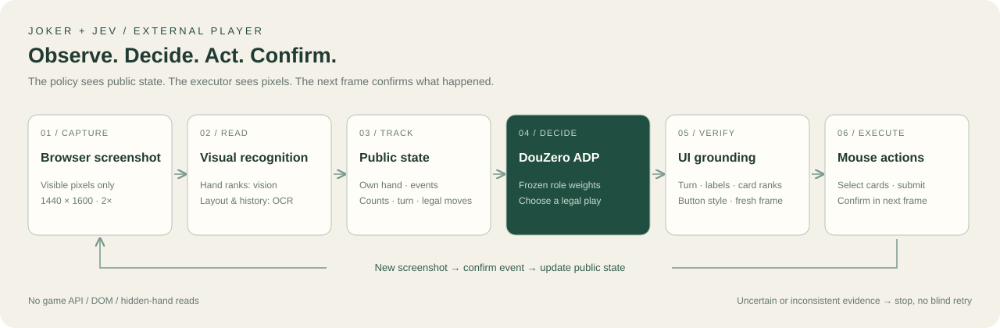
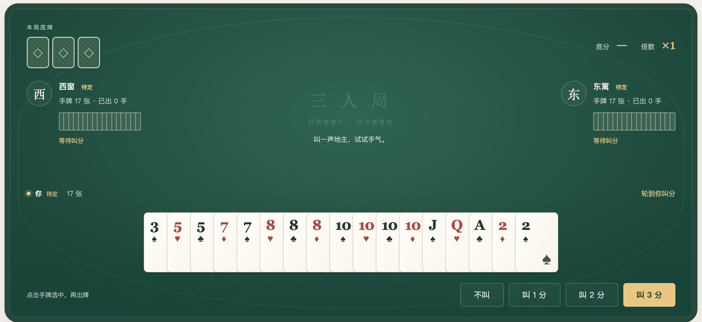

# Joker + JEV

English | [中文](README_ZH.md)

[](LICENSE) · [Architecture](docs/external-player.md) · [Vision backends](docs/vision-backends.md)

A screenshot-driven external Dou Dizhu player. **DouZero's open pretrained weights choose the cards; Jev-compatible vision recognizes UI targets; the executor clicks them and confirms the result from a new screenshot.** The external player does not read game APIs, DOM, JavaScript state, or opponents' hidden hands.

`main` follows this architecture. The previous implementation, where JEV chose the strategy, is preserved at [`old-feat/jev-decision`](https://github.com/zoroperona/joker-jev/tree/old-feat/jev-decision), including its original documentation and experiment results. Shared rules and legacy evaluation tools remain in this tree for compatibility.

## Flow



Hand ranks can be read by an image-capable System One service. Layout, player counts, roles and visible table history currently use macOS OCR. A fixed green-table pixel adapter checks button styling. Jev handles perception and UI mapping, not card strategy; bidding is manually chosen or explicitly fixed with `--bid`.

## Responsibilities

| Stage | Input and responsibility | Output |
| --- | --- | --- |
| Recognition | Image-based own-hand reading; OCR for roles, opponent counts and visible event history | Card targets and public events |
| State tracking | Merge plays/passes; validate counts, turns and move legality | Own hand, public history, unseen pool and legal actions |
| Strategy | Frozen DouZero ADP weights for the current role score legal actions | Cards to play or pass |
| UI execution | Jev verifies turn, labels and card corners; a pixel adapter checks button styling | Coordinate clicks, followed by screenshot confirmation |

The unseen pool combines all unobserved cards; it is not an allocation of opponents' real hands. Cards leave the tracked hand only after the screenshot confirms the play, not when clicks are submitted.

## Table preview



Cropped from an existing synthetic-game test fixture at the bidding stage. The current adapter reconstructs both opponents' events from the visible table history; separate left/right play-area detection is not implemented yet.

## Quick start

The current screen profile requires **macOS, Python 3.11, uv, Xcode Command Line Tools (`swiftc`), and an image-capable vision backend**. It targets the included browser table at a 1440×1600 viewport and 2× pixel density; it is not yet a general adapter for other games or skins.

```sh
git clone https://github.com/zoroperona/joker-jev.git
cd joker-jev
bash games/doudizhu/setup.sh
uv pip install --python games/doudizhu/.venv/bin/python -e '.[external]'
games/doudizhu/.venv/bin/python -m playwright install chromium
cp configs/vision-local.env.example .env.vision
```

Configure `.env.vision` for your own service. The local example points to localhost and does not start a model server. See [vision backends and self-hosting](docs/vision-backends.md) for model, hardware and protocol requirements. A Jev-compatible endpoint or model alias alone does not guarantee image support; the previously tested official endpoint rejected images. No developer-private endpoint or credentials are required or published.

```sh
# Terminal 1: manual player seat, DouZero opponents
bash games/doudizhu/start.sh --port 8877 --seed 42 --delay 1.5

# Terminal 2: screenshot-only external player; fixed bid of 3
games/doudizhu/.venv/bin/python -m joker_jev.external \
  --url http://127.0.0.1:8877 --env-file .env.vision \
  --execute --bid 3 --vision jev --ui-policy jev \
  --output games/doudizhu/runs/external-001
```

Use a new output directory for each run. Keep the table's player seat in manual mode. The tool starts its own browser window, plays one game, and stops; it does not support joining midway through a game. Screenshot inconsistency, unreadable targets or unconfirmed clicks stop execution without blind retries.

## Validation and limits

- 119 main tests and 7 browser-server tests passed in the current development environment.
- Image-driven seed 46 completed with 37 screenshot-confirmed plays/passes; held-out seed 47 completed with 21. These are completion checks, not win-rate or long-term reliability claims.
- The current client reads the on-screen table history to reconstruct both opponents' events. Separate left/right play-area recognition is a future adapter.
- Fixed layout, fonts, palette and visible history length limit compatibility. Opponents were tested with a 1.5-second delay. Hidden hands are never supplied to the external policy.

```sh
games/doudizhu/.venv/bin/python -m unittest discover -s tests
games/doudizhu/.venv/bin/python -m unittest discover -s games/doudizhu -p 'test_*.py'
```

[Architecture and execution](docs/external-player.md) · [Vision backend setup](docs/vision-backends.md) · [Research and failure records](docs/vision-research.md) · [Browser table](games/doudizhu/README.md) · [Rules](docs/full-doudizhu.md)

Private `.env` files, downloaded model weights and runtime screenshots/logs remain git-ignored. Public reports and fixtures contain synthetic test games.

## License and attribution

Original project code, documentation and project-authored illustrations are licensed under **[Apache License 2.0](LICENSE)**; see [NOTICE](NOTICE) for attribution. The license permits use, modification and commercial redistribution subject to its notice, modification and other conditions. The software is provided as-is.

**Third-party components retain their own terms.** DouZero code is Apache-2.0. Downloaded strategy checkpoints are the DouZero ADP baseline distributed in the Apache-2.0 PerfectDou repository. The tested optional `pplx-decider-v1.1-27b` vision model declares Apache-2.0 in its model card; hosted API use is governed separately by provider terms. Model weights are not bundled in this repository.

See [THIRD_PARTY_NOTICES.md](THIRD_PARTY_NOTICES.md) for sources, pinned revisions, dependency licensing and image provenance. This project is not affiliated with or endorsed by the upstream model or service providers.
